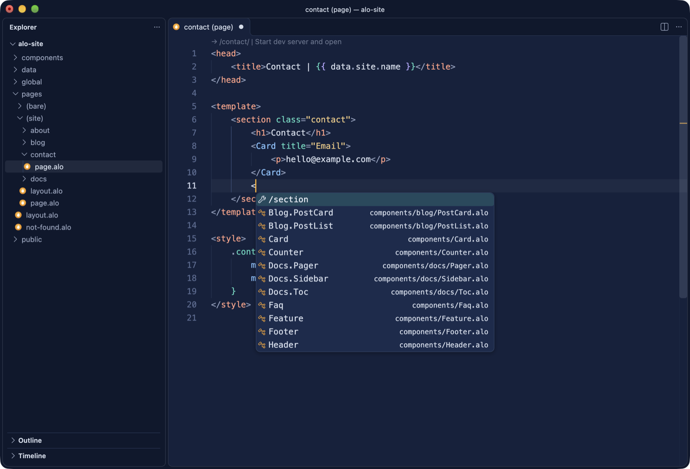
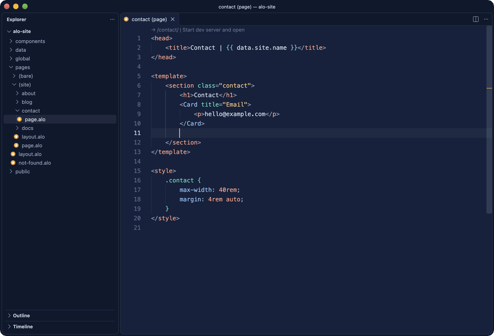
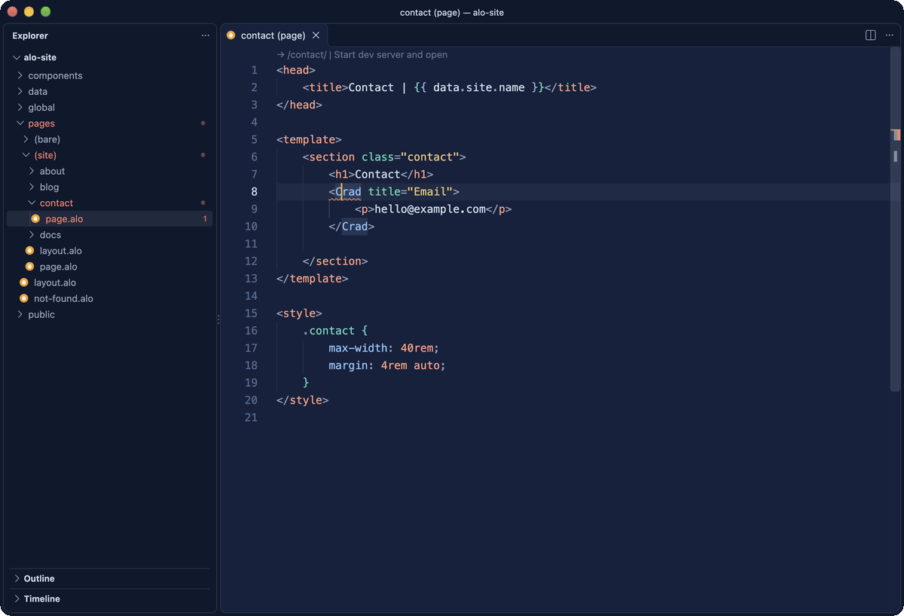

# Alo for VS Code

Editor support for [Alo](https://github.com/msilabs/alo), the lightweight static web framework where you write plain HTML, CSS and JS with components, layouts, loops and conditions.

The extension uses Alo's own code to understand your project, so the editor follows the same rules as `node alo build`: the same component names, the same errors, the same hints.

## Features

**Highlighting.** `.alo` files are HTML, with `{{ }}`, `{{{ }}}` and `<template for / if / else-if / else>` coloured as JavaScript, component tags coloured like classes, and CSS and JS inside `<style>` and `<script>` with their own comments, brackets and suggestions.

**Components.**
- Type `<` to get your components, including folders: `<Blog.PostCard>`.
- Type a space inside `<Card ` to get the props `Card` reads, written as attributes (`post-date` for `props.postDate`).
- Cmd/Ctrl+Click a component tag to open its file. Hover it to see the props it reads.

**Data.** Inside `{{ }}` and `<template for="...">`:
- `data.` lists your `data/` files and their keys, with their values.
- `item.` on a `[slug]` page lists the fields of its posts.
- A loop variable (`post.` in `for="post in data.blog"`) lists the fields of the list items.
- `props.` in a component lists the props it reads and the ones pages pass to it.
- Cmd/Ctrl+Click `data.site.name` to open `data/site.json` at `"name"`.

**Alo's errors while you type.** Alo checks your project as you type, without saving, and shows its errors and warnings with their hints. An error inside a component links to the page that used it.

**Quick fixes** (Cmd/Ctrl+.) for what Alo suggests:

| Alo says | Quick fix |
| --- | --- |
| Component `<Crad>` not found. Did you mean `<Card>`? | Rename the tag and its closing tag |
| Create the component: `components/Testimonial.alo` | Create the file and open it |
| `<Card>` never uses `titel`. Did you mean `title`? | Rename the attribute |
| `dat` is not defined. Did you mean `data`? | Rename the variable |
| `<li if>` will not work | Wrap the element in `<template if>` |
| `for` and `if` cannot be on the same `<template>` | Nest the `if` inside the loop |
| `sort()` / `reverse()` changes data | Use `toSorted()` / `toReversed()` |
| The layout has no `<slot />` | Add `<slot />` |

**Pages and layouts.** Above each page: its URL (`→ /blog/:slug/ · 5 pages`) and a button to open it in the browser. Above each layout: how many pages it wraps. Tabs show `about (page)` instead of a row of `page.alo`.

**Commands** (Cmd/Ctrl+Shift+P):

| Command | What it does |
| --- | --- |
| Alo: New… | Creates a page, layout, component or post, like `alo new`, and opens it |
| Alo: Start Dev Server / Stop Dev Server | Runs `alo dev` (or `adhar dev` in an Adhar full stack project) in a terminal; the status bar shows its address |
| Alo: Open Dev Server in Browser | Opens the running dev server |
| Alo: Build | Runs `alo build` into `dist/` |
| Alo: Open .alo Files as Alo | Removes a `files.associations` setting that opens `.alo` files as HTML |
| Alo: Show Log | Shows which Alo the extension uses for each project |

**Also:** snippets (`tfor`, `tif`, `tifelse`, `aloc`, `alop`, `alol`, …), Emmet, HTML tag and attribute suggestions and hovers, and `{{` becoming `{{ | }}`.

## Which Alo it uses

If the project has `node_modules/@msilabs/alo` (Alo 1.2.1 or newer; older versions have known security problems), the extension uses that, so the editor and your builds always agree. Otherwise it uses the copy of Alo that comes with the extension.

## Restricted Mode

In a folder you have not trusted, the extension does not check for errors and does not run the dev server or builds, because those run the code in your templates. It also does not load the project's own Alo. Highlighting, suggestions, hovers and creating files still work. Trust the folder to turn everything on.

## Security and privacy

- **Code it runs:** only in trusted folders, `alo dev` and `alo build` through `child_process.spawn` with an argument array (never a shell string), using VS Code's own Node.
- **Expressions and Markdown:** Alo's expressions are read by a parser, never compiled with `new Function` or `eval`. Markdown escapes raw HTML and keeps only safe link schemes.
- **Environment variables:** the extension reads only the ones it hands to `alo dev` and `alo build`: only `PATH`, `HOME`, `USERPROFILE`, `SystemRoot`, `TEMP`, `TMP`, `TMPDIR`, `LANG` and `LC_ALL`, plus `ELECTRON_RUN_AS_NODE` and `NO_COLOR` set by the extension.
- **Network:** the extension makes no outgoing network calls and sends no telemetry. The only network use is the dev server of `alo dev`, which listens on `localhost` (default port 3000, or the next free one). The extension reads its address from the server's output and opens it in your browser when you ask.

## Projects made with `alo init`

New projects get a `.vscode/extensions.json` that recommends this extension, so VS Code offers to install it.

Projects made with an older `alo init` have `"files.associations": { "*.alo": "html" }` in `.vscode/settings.json`. With that setting, VS Code opens `.alo` files as HTML and this extension cannot help. The extension notices it and offers to remove it; you can also run **Alo: Open .alo Files as Alo**.

## Adhar full stack projects

In a project made with `adhar init --web`, the site is in `web/` and the extension works there as usual: errors, suggestions, CodeLens and **Alo: Build**. **Alo: Start Dev Server** runs `adhar dev` there, so the API and the site share one port, and the status bar shows its address. Run `npm install` in the project first. In other projects it runs `alo dev`.

## Known limits

- Alo stops at the first error, so only one error is shown at a time; warnings are all shown.
- Format Document is not supported for `.alo` files.
- The extension needs a folder on disk; it does not work in virtual workspaces like github.dev.

## Feedback

Problems and ideas: [github.com/msilabs/alo-vscode/issues](https://github.com/msilabs/alo-vscode/issues).
